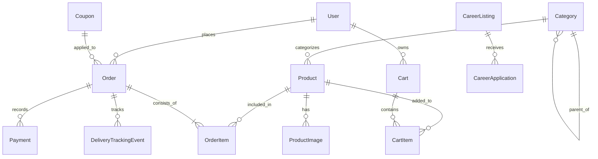

# SHOILPIKKABBO — Database Design (PostgreSQL + Prisma)

This document establishes the relational data architecture to be implemented with Prisma ORM in Phase 5.

---

## 1. Relational Entity Relationship Diagram (ERD)

---

## 2. Core Entities & Field Specifications

### 2.1 User & Authentication
- `id` (UUID, PK)
- `name` (VarChar)
- `email` (VarChar, Unique, Nullable)
- `phone` (VarChar, Unique, Indexed)
- `passwordHash` (VarChar)
- `role` (Enum: `ADMIN`, `STAFF`, `CUSTOMER`)
- `createdAt`, `updatedAt` (Timestamp)

### 2.2 Category
- `id` (UUID, PK)
- `name` (VarChar)
- `slug` (VarChar, Unique, Indexed)
- `description` (Text, Nullable)
- `imageUrl` (VarChar, Nullable)
- `parentId` (UUID, FK to Category, Nullable for subcategories)
- `displayOrder` (Int, Default: 0)
- `isActive` (Boolean, Default: true)

### 2.3 Product & ProductImage
- **Product:**
  - `id` (UUID, PK)
  - `categoryId` (UUID, FK, Indexed)
  - `name` (VarChar)
  - `slug` (VarChar, Unique, Indexed)
  - `description` (Text)
  - `price` (Decimal(12, 2))
  - `salePrice` (Decimal(12, 2), Nullable)
  - `stock` (Int, Default: 0)
  - `sku` (VarChar, Unique, Nullable)
  - `isFeatured` (Boolean, Default: false)
  - `isActive` (Boolean, Default: true)
- **ProductImage:**
  - `id` (UUID, PK)
  - `productId` (UUID, FK, Cascade Delete)
  - `url` (VarChar)
  - `altText` (VarChar, Nullable)
  - `isPrimary` (Boolean, Default: false)
  - `displayOrder` (Int, Default: 0)

### 2.4 Order & OrderItem
- **Order:**
  - `id` (UUID, PK)
  - `orderNumber` (VarChar, Unique, Indexed, e.g., `SK-2026-1001`)
  - `userId` (UUID, FK, Nullable for Guest Checkout)
  - `customerName` (VarChar)
  - `customerPhone` (VarChar, Indexed)
  - `customerEmail` (VarChar, Nullable)
  - `shippingAddress` (Text)
  - `city` (VarChar, e.g., "Dhaka", "Chattogram")
  - `postalCode` (VarChar, Nullable)
  - `deliveryNotes` (Text, Nullable)
  - `subtotal` (Decimal(12, 2))
  - `deliveryCharge` (Decimal(12, 2))
  - `discountAmount` (Decimal(12, 2), Default: 0.00)
  - `totalAmount` (Decimal(12, 2))
  - `couponCode` (VarChar, Nullable)
  - `orderStatus` (Enum: `PENDING`, `CONFIRMED`, `PROCESSING`, `SHIPPED`, `DELIVERED`, `CANCELLED`)
  - `paymentStatus` (Enum: `PENDING`, `PARTIALLY_PAID`, `PAID`, `REFUNDED`, `FAILED`)
  - `createdAt`, `updatedAt` (Timestamp)
- **OrderItem:**
  - `id` (UUID, PK)
  - `orderId` (UUID, FK)
  - `productId` (UUID, FK)
  - `productName` (VarChar)
  - `unitPrice` (Decimal(12, 2))
  - `quantity` (Int)
  - `totalPrice` (Decimal(12, 2))

### 2.5 Payment & Verification
- `id` (UUID, PK)
- `orderId` (UUID, FK)
- `method` (Enum: `BKASH_MANUAL`, `NAGAD_MANUAL`, `BANK_TRANSFER`, `CASH_ON_DELIVERY`, `ONLINE_GATEWAY`)
- `transactionId` (VarChar, Nullable, Indexed)
- `senderPhone` (VarChar, Nullable)
- `bankReference` (VarChar, Nullable)
- `amount` (Decimal(12, 2))
- `status` (Enum: `PENDING_VERIFICATION`, `VERIFIED`, `REJECTED`)
- `verifiedByUserId` (UUID, FK to User, Nullable)
- `verificationNotes` (Text, Nullable)
- `createdAt`, `verifiedAt` (Timestamp)

### 2.6 Service Inquiry (Special E-Sheba)
- `id` (UUID, PK)
- `serviceType` (VarChar, e.g., "Corporate Custom Sourcing", "Technical Consultation")
- `customerName` (VarChar)
- `customerPhone` (VarChar)
- `customerEmail` (VarChar, Nullable)
- `organization` (VarChar, Nullable)
- `requirements` (Text)
- `status` (Enum: `NEW`, `IN_REVIEW`, `CONTACTED`, `COMPLETED`, `CLOSED`)
- `adminNotes` (Text, Nullable)
- `createdAt`, `updatedAt` (Timestamp)

### 2.7 Career Listings & Applications
- **CareerListing:** `id`, `title`, `department`, `location`, `employmentType`, `description`, `requirements`, `deadline`, `isActive`
- **CareerApplication:** `id`, `careerListingId`, `applicantName`, `applicantPhone`, `applicantEmail`, `resumeUrl`, `notes`, `status`

### 2.8 Supporting Entities
- `Coupon`: `id`, `code`, `discountType`, `discountValue`, `minOrderAmount`, `maxDiscountAmount`, `startDate`, `endDate`, `usageLimit`, `usageCount`, `isActive`
- `Banner`: `id`, `title`, `subtitle`, `imageUrl`, `linkUrl`, `placement`, `displayOrder`, `isActive`
- `SiteSetting`: `id`, `key` (Unique), `value`, `category`, `description`
